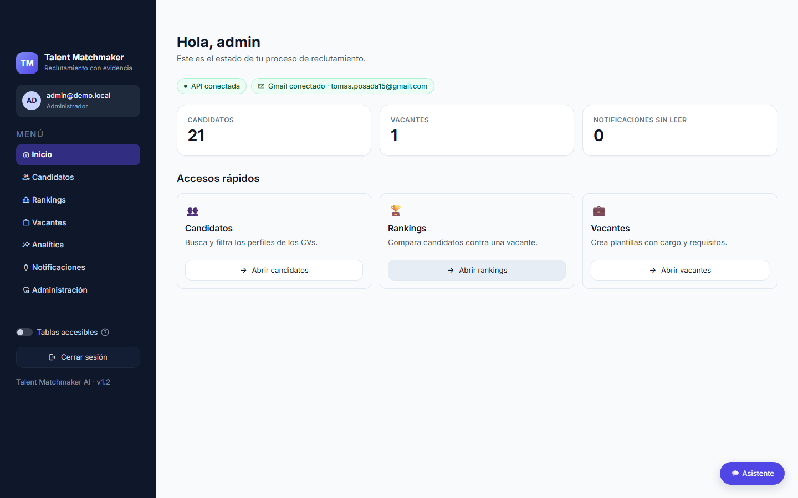
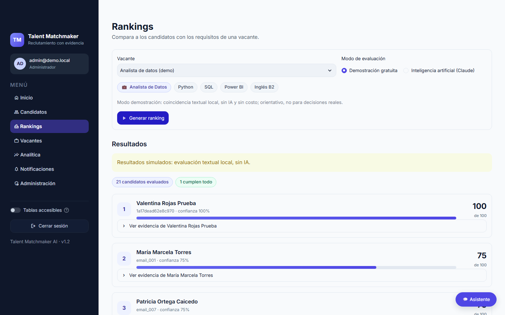
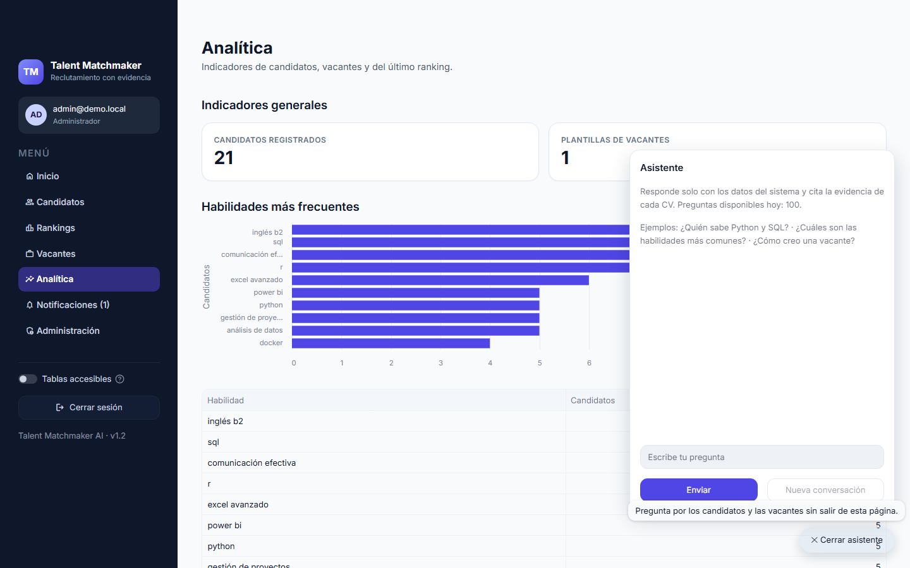

# Talent Matchmaker AI

Sistema de preselección de candidatos. Lee las hojas de vida que llegan por
correo, extrae un perfil estructurado donde **cada dato apunta a la evidencia
textual del CV** y compara a los candidatos contra una vacante con un
ranking que se justifica línea por línea.

Principio del producto: ningún dato se inventa. Si no está en el CV, queda
en `null`, y si un requisito no tiene evidencia, el ranking lo declara.

Equipo: Tomás Posada · Mateo Arango · Sara Jaramillo.

## Cómo funciona

```
Gmail ──► Listener ──► ClamAV ──► Extracción ──► Perfil + evidencia ──► PostgreSQL
                                  (PDF/DOCX/OCR)    (schema validado)          │
                                                                               ▼
              Dashboard (Streamlit) ◄──── API REST (FastAPI + JWT) ◄──── Agente de ranking
              login, candidatos,                                          (Claude + tools que
              vacantes, rankings,                                          verifican evidencia)
              analítica, administración + asistente flotante
```

El detalle de cada componente está en [docs/architecture.md](docs/architecture.md).

| Inicio | Ranking con evidencia | Asistente |
|---|---|---|
|  |  |  |

## Inicio rápido (Docker)

Requisitos: Docker con Compose v2 y unos 4 GB de RAM libres.

```bash
cp .env.example .env        # completa POSTGRES_PASSWORD, JWT_SECRET y DEMO_ADMIN_PASSWORD
docker compose up -d --build
docker compose run --rm api python scripts/seed_demo.py
```

Abre http://localhost:8501 e inicia sesión con `DEMO_ADMIN_EMAIL` /
`DEMO_ADMIN_PASSWORD`. El script de demostración procesa 25 correos
sintéticos (20 de 21 CVs válidos quedan registrados) y crea una vacante de
ejemplo. En **Rankings**, el modo *Demostración gratuita* funciona sin llave
de Claude; el modo IA necesita `ANTHROPIC_API_KEY`.

Gmail real, HTTPS en producción, backups y diagnóstico: ver
[docs/runbook.md](docs/runbook.md).

## Desarrollo local

Requiere Python 3.11 o superior.

```bash
python -m venv .venv && source .venv/bin/activate      # Windows: .venv\Scripts\activate
pip install -r requirements-dev.txt -c constraints.txt
ruff check .
pytest -q
```

Las pruebas no necesitan PostgreSQL, ClamAV ni red: usan dobles de prueba.
Para correr los servicios fuera de Docker, define `DATABASE_URL`,
`JWT_SECRET` (mínimo 32 caracteres) y, si quieres, `CLAMAV_HOST`, y luego:

```bash
uvicorn src.api:app --reload                  # API en :8000 (Swagger en /docs)
streamlit run dashboard/main.py               # dashboard en :8501
python run_listener.py                        # listener de Gmail
```

Cada pull request pasa por CI (`.github/workflows/ci.yml`): ruff, pytest,
`pip-audit` y la construcción de la imagen Docker.

## Estructura

```
src/
  pipeline.py, email_detector.py, gmail_inbox.py, email_polling.py   ingesta
  attachment_handler.py, malware_scanner.py, text_extractor.py       adjuntos, ClamAV, PDF/DOCX/OCR
  profile_structurer.py, schema.py                                   perfil con evidencia
  vacancy_structurer.py, agent.py, agent_tools.py, demo_ranking.py   ranking (IA y demostración)
  chatbot.py                                                         asistente conversacional
  api.py, auth.py                                                    API REST, JWT y roles
  profile_repository.py, job_template_repository.py                  PostgreSQL
  observability.py, privacy.py                                       métricas, alertas, PII
  ranking_exporter.py, email_notifier.py                             exportación y notificaciones
dashboard/                                                           Streamlit
scripts/                                                             demo, carga, admin, purga, backups
tests/                                                               pytest
docs/                                                                documentación
monitoring/, deploy/                                                 Prometheus y Caddy
```

## Documentación

| Documento | Contenido |
|---|---|
| [docs/architecture.md](docs/architecture.md) | Componentes, flujo de datos, modelo de datos y decisiones de diseño |
| [docs/runbook.md](docs/runbook.md) | Despliegue, operación, backups y recuperación |
| [docs/monitoring.md](docs/monitoring.md) | Métricas, alertas, health checks y logs |
| [docs/security-review.md](docs/security-review.md) | Revisión OWASP Top 10 |
| [docs/privacy.md](docs/privacy.md) | Datos personales, retención y derechos del titular |
| [docs/accessibility.md](docs/accessibility.md) | Auditoría WCAG 2.1 AA del dashboard |
| [docs/performance.md](docs/performance.md) | Pruebas de carga y límites de escala |
| [docs/uat-plan.md](docs/uat-plan.md) | Plan de pruebas de aceptación con reclutadores |
| [docs/retrospective.md](docs/retrospective.md) | Retrospectiva del proyecto y traspaso |
| [SPRINT_REVIEW.md](SPRINT_REVIEW.md) | Product Goal, Sprint Goals y backlog por sprint |

## Limitaciones conocidas

- `GET /profiles` devuelve todos los perfiles: hay que paginarlo antes de
  llegar a unos 5.000 candidatos ([docs/performance.md](docs/performance.md)).
- El asistente y el ranking con IA necesitan `ANTHROPIC_API_KEY`
  ([docs/runbook.md](docs/runbook.md), sección 2).
- El ranking con IA es síncrono y no tiene cuota por usuario
  ([docs/security-review.md](docs/security-review.md), A04).
- La exportación de rankings a CSV/PDF (`src/ranking_exporter.py`, #42)
  existe como librería, pero todavía no está expuesta en la API ni en el
  dashboard.
- La analítica (#58) muestra habilidades y puntajes; el *time-to-hire* y el
  embudo de contratación necesitan registrar el estado de cada candidato en
  el proceso, y hoy ese dato no existe.
- Falta el aviso de privacidad para candidatos, que requiere revisión legal
  ([docs/privacy.md](docs/privacy.md)).
